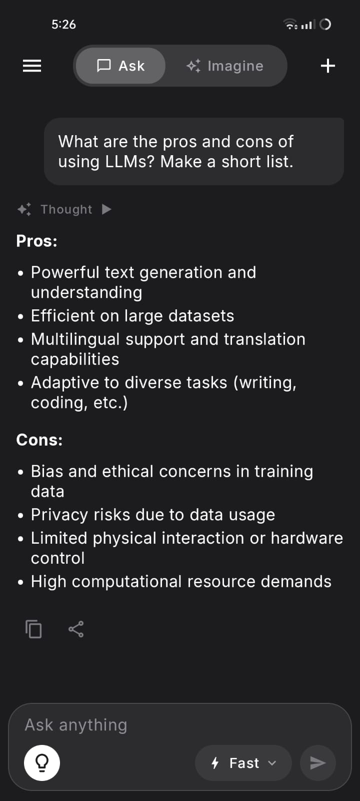
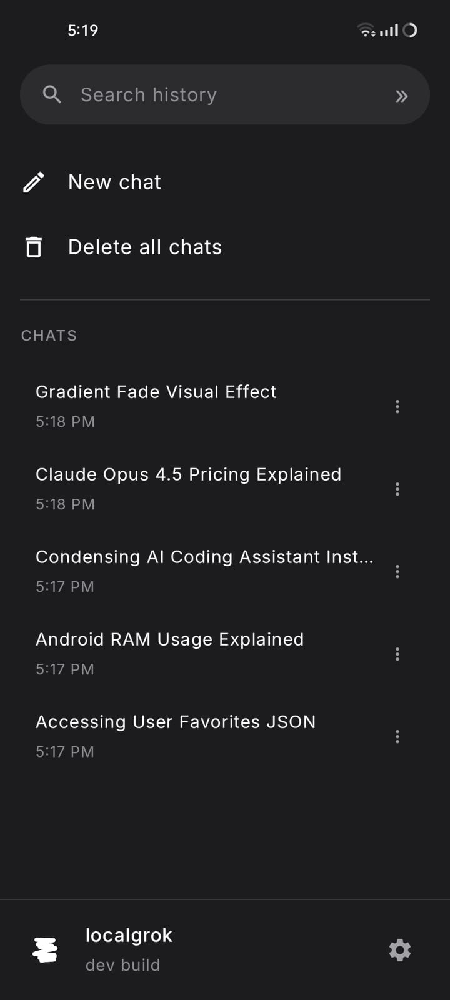
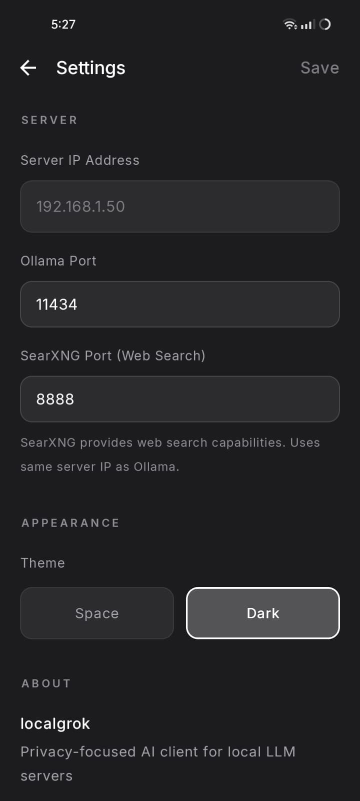
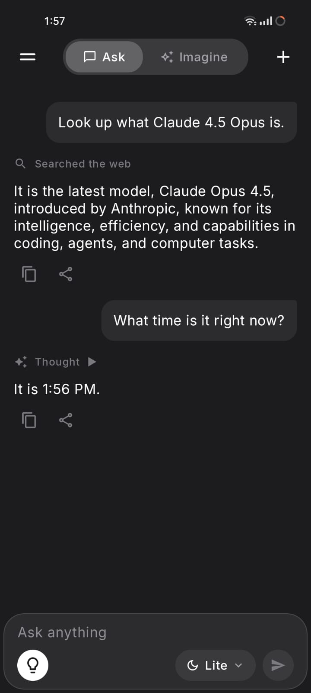

# localgrok

An Android app for chatting with Ollama on your own server.

## What is this?

localgrok connects your phone to an Ollama server, streams replies as they're generated, and saves your chats on your phone. You can switch models, browse your history, and choose between two dark themes.

With SearXNG set up, the Think model can also search the web.

## Screenshots

| Chat | Chat history |
| --- | --- |
|  |  |

| Settings | Web search |
| --- | --- |
|  |  |

Screenshots show an earlier version, so some labels may differ.

## How do I run it?

You'll need an Android phone running Android 8.0 or newer and a computer running [Ollama](https://ollama.com). Keep both devices on the same trusted network.

### Set up Ollama

Download at least one model on your computer:

```sh
ollama pull gemma3:1b-it-qat
```

To use the app's Think mode, also download:

```sh
ollama pull qwen3:1.7b
```

Ollama needs to accept connections from your phone. Set `OLLAMA_HOST` to `0.0.0.0:11434` and restart Ollama. The [Ollama setup guide](https://docs.ollama.com/faq#how-do-i-configure-ollama-server) explains how to do this on Windows, macOS, and Linux.

Allow connections to port `11434` through your computer's firewall on your trusted network. Keep this unauthenticated server off the public internet.

### Build the Android app

Open this project in a recent Android Studio that supports Android Gradle Plugin 8.13. Let Gradle finish syncing, then use **Run** to install it on your connected phone or emulator.

For a terminal build, use JDK 17 and Android SDK 35:

```sh
./gradlew assembleDebug
```

On Windows:

```powershell
.\gradlew.bat assembleDebug
```

The APK is saved to `app/build/outputs/apk/debug/app-debug.apk`. The fonts are already included; there's nothing extra to download for them.

### Connect your phone

1. Open the app and go to **Settings**.
2. Enter your computer's local IP address or hostname, without `http://` or a port.
3. Use port `11434` for Ollama, then tap **Save**.
4. Return to the chat and choose one of the models on your server.

Type a message and send it. Tap **Stop** to stop a response. Open the sidebar to start another chat or return to an existing one.

## How does web search work?

Run [SearXNG](https://docs.searxng.org/admin/installation.html) on the same computer as Ollama and enter its port in Settings. The app defaults to `8888`; change it if your instance uses another port.

Enable JSON results in SearXNG's `settings.yml`:

```yaml
search:
  formats:
    - html
    - json
```

Choose **Think** (`qwen3:1.7b`) in the model picker. It can request a search when your question needs current information. Search depends on the model following the tool format and isn't guaranteed for every question.

## Where does my data go?

Chats and settings are stored on your phone, and Android backups are disabled for them. Messages are sent to the Ollama server you configure. Using a local model keeps generation on that server; a cloud-backed model can send data elsewhere.

Web searches send queries to your SearXNG instance, which contacts search engines. Connections from the app use HTTP, so use a network you trust.

## Something isn't working

- **Can't connect:** Check the server address, Wi-Fi network, firewall, and Ollama's `OLLAMA_HOST` setting.
- **No models appear:** Run `ollama list` on your computer and make sure a model is installed.
- **Search fails:** Check the SearXNG port and make sure JSON results are enabled. Public instances may block API requests.
- **A reply stops early:** The app will show an error. Check the server and try again; partial text is kept.

The Imagine tab is a placeholder. Image generation is not available.

## Development

Run the unit tests with:

```sh
./gradlew testDebugUnitTest
```

Use `gradlew.bat` instead on Windows. The tests use sample responses and don't need an Ollama server.

## Credits and license

Built with Kotlin, Jetpack Compose, Ollama, and optional SearXNG search. Font credits and licenses are in [docs/THIRD_PARTY.md](docs/THIRD_PARTY.md).

Cleanup and documentation updates were assisted by Codex, OpenAI's AI coding assistant.

Released under the [MIT License](LICENSE).
